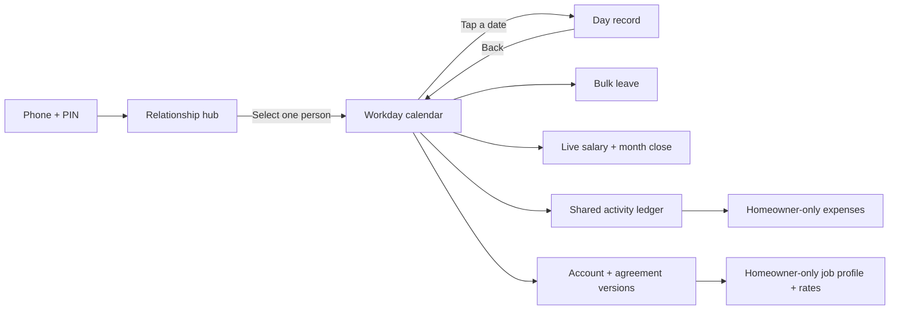

# SaafHisaab UX first-principles audit

Date: 2026-10-28
Scope: homeowner and worker journeys for the controlled pilot

## Product job

A homeowner needs to answer three questions with minimal effort and without hidden arithmetic:

1. What happened on each expected workday?
2. What has been mutually confirmed, and what is still pending or disputed?
3. What is the live and final salary under the agreement that applied that month?
4. What replacement-food or grocery costs did the household incur, without confusing those costs with salary?

A worker needs to see the same factual ledger, request corrections or leave, and understand the final payment without being exposed to private homeowner-only deduction weights.

## Navigation model



The selected `pairId` remains the authorization boundary. Calendar navigation never broadens access beyond that pair.

## First-principles rules

1. **Start from the user’s time horizon.** Payroll is monthly, so the selected pair opens on the calendar rather than an isolated “today” form.
2. **Normal work should be cheap.** One tap records a fully completed day; detailed controls are for exceptions.
3. **Exceptions need context.** A day screen uses the actual date as its heading and returns directly to the month.
4. **Batch known information.** Multiple leave dates can be selected and saved together.
5. **Never hide state.** Calendar markers distinguish done, pending, leave/miss, disputed, and unrecorded dates.
6. **Do not collapse three states into one checkbox.** Each activity needs `Done`, `Missed`, and `N/A`; a binary checkbox cannot represent household-cancelled or not-required work honestly.
7. **Money rules are data.** Working days, leave allowance, category allocations, activity allocations, and expected occurrences are homeowner-editable agreement data.
8. **History must not be rewritten.** Rate changes are versioned by effective month and cannot be applied across an already locked payment.
9. **Workers see outcomes, not private weights.** Both people see category totals and final adjustment; internal activity rates remain homeowner-only.
10. **Do not invent hourly payroll.** Hourly mode requires explicit rules for scheduled hours, breaks, rounding, overtime, paid leave hours, missing punches, and approval. Until those are agreed, the production calculator stays monthly plus activity exceptions.
11. **A role is data, not a screen fork.** Job functions, categories, cadence, occurrences and allocations are versioned profile data; the day and month screens render them dynamically.
12. **Household costs are not payroll deductions.** Outside food, groceries and other expenses stay homeowner-only and never silently reduce worker pay.

## Screen-by-screen evaluation

| Screen | Primary question | Audit finding | Implemented response |
| --- | --- | --- | --- |
| Login | How do I enter? | Server URL was inappropriate customer plumbing. | Phone + PIN only; endpoint is publisher configuration. |
| Relationship hub | Whose payroll am I opening? | Correct conceptual boundary; remote ledger cache could reopen a previous pair directly. | Remote sessions now return to the hub; pair data loads only after selection. |
| Calendar | Which days need attention? | Calendar existed but was secondary and used weak dot-only markers. | Pair opens on Calendar; markers have symbols, labels, and accessible date/status names. |
| Day record | What happened on this date? | Past dates were still titled “Today’s work” and had no return to month. | Actual date heading, Calendar back action, clearer tri-state activity controls. |
| Bulk leave | Can I record several known leaves once? | Missing. | Month day-selector with shared duration, notice and note; reuses normal validation and review. |
| Month/pay | What is current and final salary? | Confirmed versus possible impact was already separated well. | Preserved; now reads the agreement version effective for that month. |
| Agreement/job functions | What work and rates were agreed? | A fixed cook/cleaner screen could not represent another employee. | Homeowner-only profile builder: add/remove functions, category, daily/flexible cadence, occurrences and allocation; versioned by month. |
| Household expenses | What did absence or household operation cost me? | Outside-food and grocery costs had nowhere structured to live. | Homeowner-only expense ledger plus an optional leave-linked outside-food entry on the day screen. Expenses never affect payroll. |
| Worker view | Can the worker change payroll? | Boundary was correct. | Still read-only; worker requests remain pending until homeowner review. |
| Backup | Can I keep my own copy? | Service-owner and homeowner Drive destinations were easy to confuse. | Scoped personal Drive flow plus separate service disaster recovery. |

## Implemented agreement model

The controlled pilot now supports versioned configuration of:

- working days per month;
- paid leave-equivalent days;
- job profile name;
- any number of named job functions and categories;
- daily or flexible-monthly cadence;
- expected flexible occurrences; and
- monthly allocation per function.

Derived values:

```text
category amount = sum of its function allocations
monthly salary = sum of every function allocation
daily-function occurrence = allocation / working days
flexible-function occurrence = allocation / configured monthly occurrences
```

Changing an agreement creates or replaces the version effective for the chosen month. Locked payments on or after that month block the change, so historical final salary cannot silently move.

## Deliberate boundary: hourly mode

An hourly-rate input without a complete contract would produce confident but ambiguous money. Before enabling hourly calculation, the product needs decisions for:

- expected hours per workday and per month;
- whether arrival/departure includes unpaid breaks;
- rounding interval and direction;
- overtime threshold and multiplier;
- paid-leave hours;
- missing arrival or departure punches;
- overnight shifts;
- homeowner/worker confirmation; and
- whether activities are included in, or additional to, hourly pay.

The data model should eventually expose a `payBasis` plug-in contract such as `monthly`, `hourly`, or `per_activity`. Only `monthly` is accepted for money calculation in this release.

## Remaining usability validation

The following require a real deployed service and physical phones:

- homeowner bulk-save followed by worker confirmation;
- agreement update followed by both phones observing the same effective version;
- narrow Android viewport and keyboard behavior;
- screen-reader announcement of calendar status markers;
- native Google Drive backup selection; and
- locked-month protection across an agreement change.
