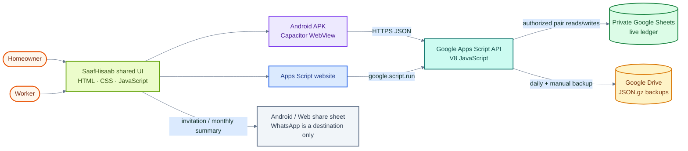
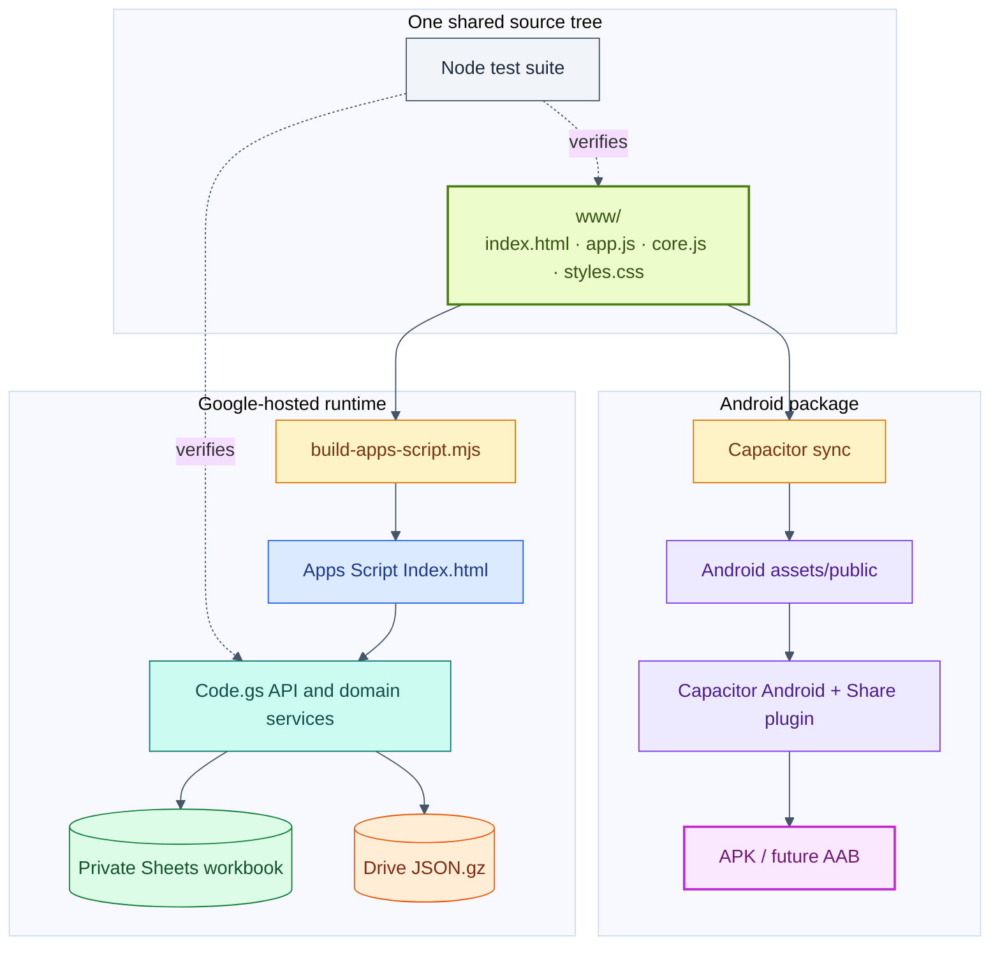
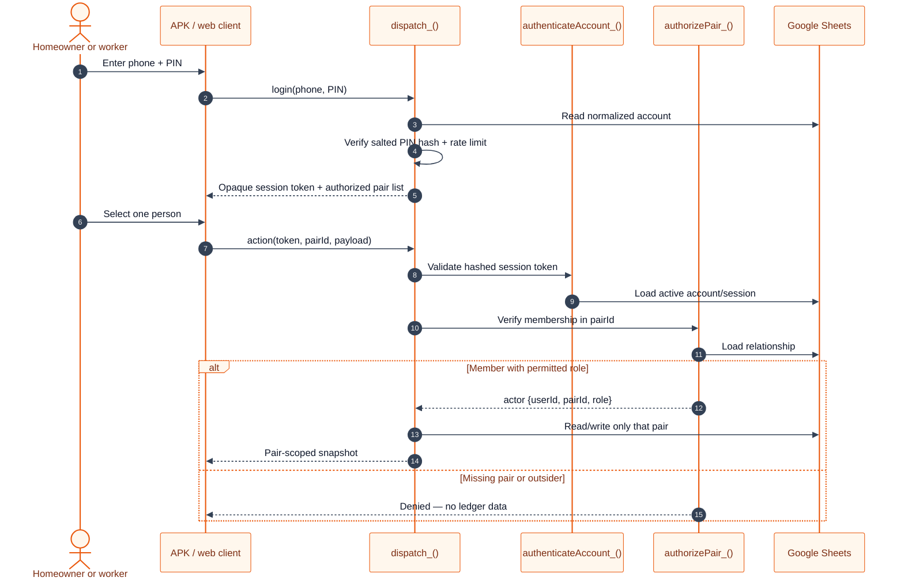
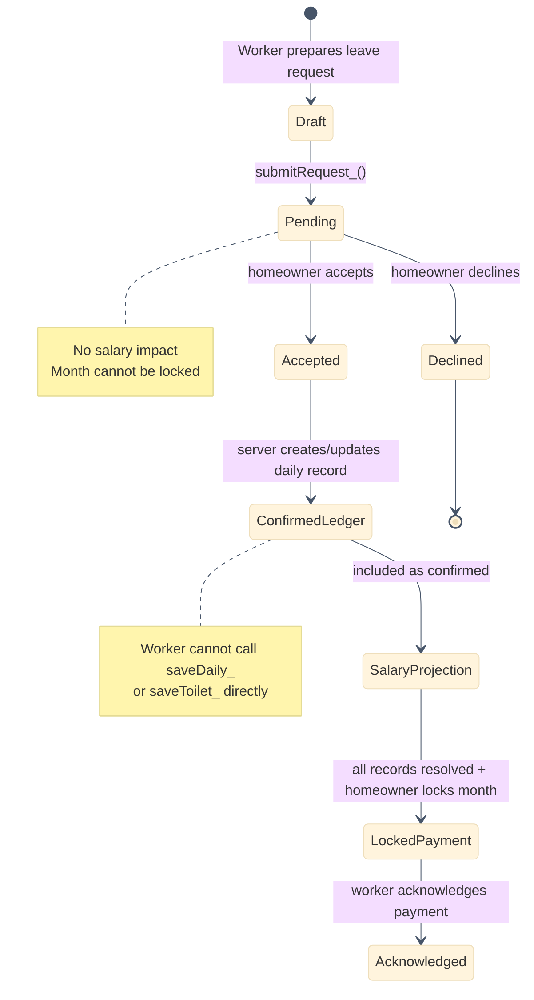
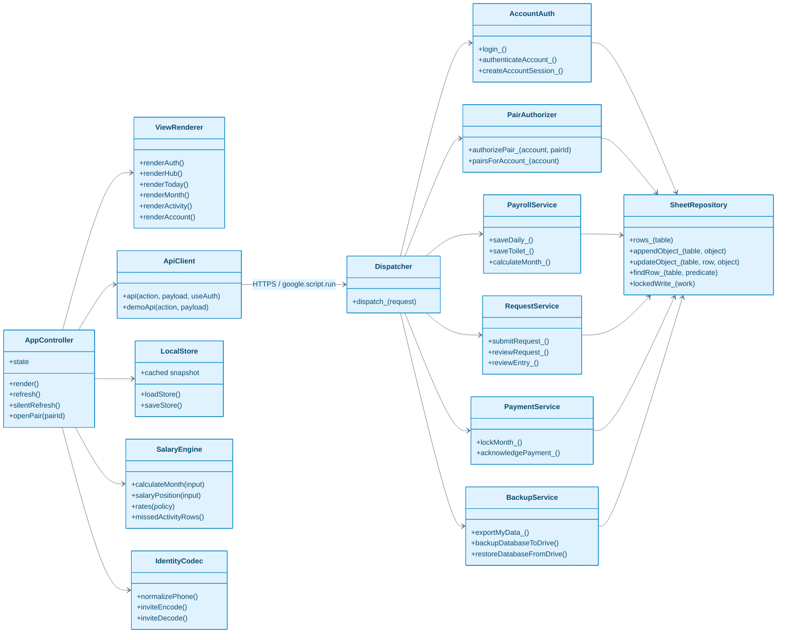
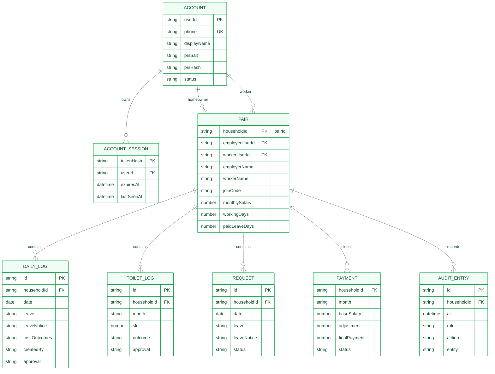
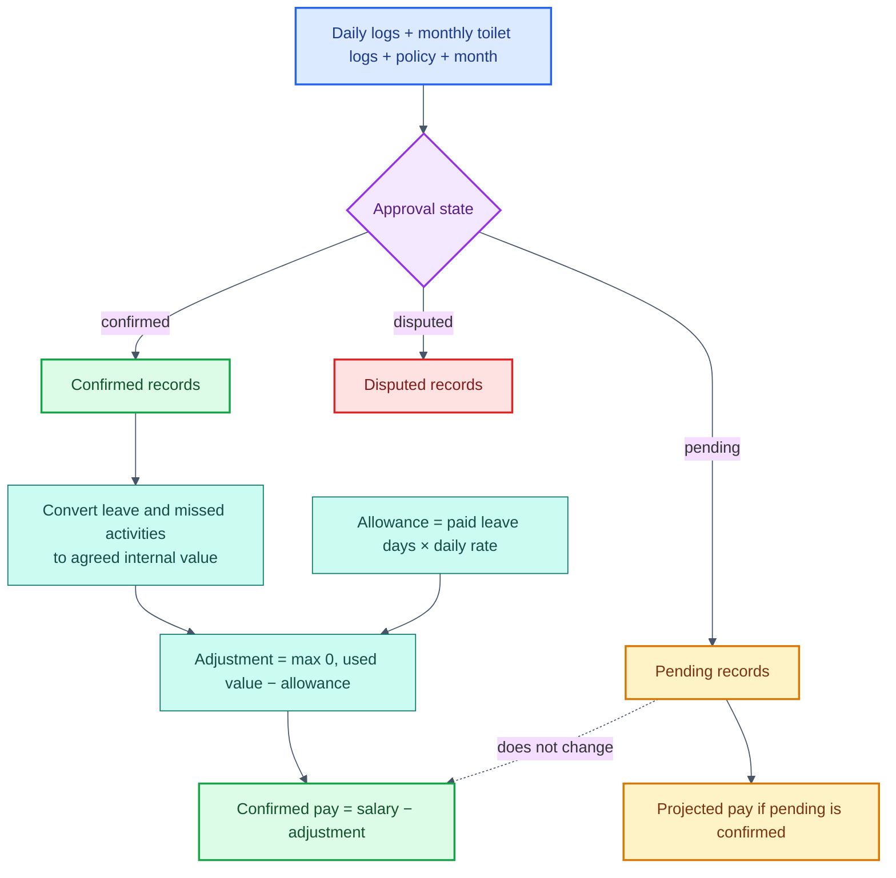
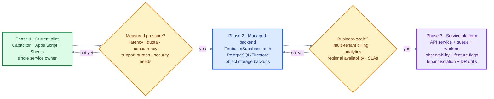
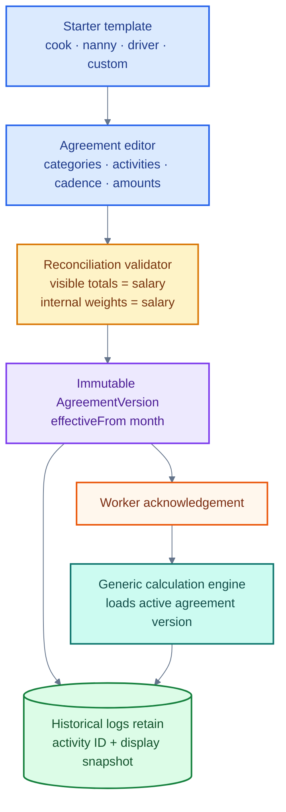

# SaafHisaab architecture atlas

This document describes SaafHisaab 2.2 as it exists today and the intended scale-up path. Diagrams marked **Current** correspond to code in `www/`, `apps-script/`, and `android/`. Diagrams marked **Proposed** are design direction, not shipped functionality.

- Open [`architecture-atlas.html`](./architecture-atlas.html) for a colorful, navigable presentation.
- Read [`adr/README.md`](./adr/README.md) for the decision log.
- Read [`../EXTENSIBLE-AGREEMENTS.md`](../EXTENSIBLE-AGREEMENTS.md) for the future profile-driven agreement model.

## 1. System context — current



## 2. Container and deployment view — current



## 3. Authentication and pair authorization — current

The phone number identifies an account, but it is not authorization by itself. Every pair-scoped operation requires a valid session token and explicit `pairId` membership.



## 4. Worker request and payroll-write boundary — current



## 5. Logical module/class view — current

The code is functional JavaScript, not an object-oriented class hierarchy. This diagram shows logical responsibilities and dependencies so future refactoring can preserve boundaries.



## 6. Data model — current



## 7. Salary calculation flow — current



## 8. Backup and restore — current

```mermaid
%%{init: {"theme":"base","themeVariables":{"actorBkg":"#ecfccb","actorBorder":"#65a30d","signalColor":"#334155","noteBkgColor":"#fef3c7","noteBorderColor":"#d97706"}}}%%
sequenceDiagram
  autonumber
  participant T as Daily trigger / owner
  participant B as BackupService
  participant S as Google Sheets
  participant D as Service-owner Drive
  participant H as Homeowner app
  participant P as Homeowner Drive

  T->>B: backupDatabaseToDrive()
  B->>S: Read all known tables
  S-->>B: Versioned rows + headers
  B->>B: JSON serialize → gzip → SHA-256
  B->>D: Store .json.gz
  B->>D: Retain newest 14 backups

  opt Homeowner personal backup
    H->>B: exportMyData()
    B->>S: Read only authorized pairs
    B-->>H: Scoped JSON.gz without credentials
    H->>P: System share sheet; homeowner selects Drive account
    Note over H,P: User confirms the file appears in personal Drive
  end

  opt Disaster recovery
    T->>B: restoreDatabaseFromDrive(fileId)
    B->>B: Create pre-restore backup
    B->>D: Read selected .json.gz
    B->>B: Validate format v2/v3 + normalize headers
    B->>S: Replace tables under script lock
    B-->>T: Restored + pre-restore backup ID
  end
```

## 9. Technology decision matrix

Scores are relative to this product at pilot stage: 5 is strongest. Cost means low operating cost; scale means headroom without migration.

| Option | Delivery speed | Shared Android/web code | Operating cost | Scale headroom | Operational simplicity | Decision |
| --- | ---: | ---: | ---: | ---: | ---: | --- |
| Vanilla JS + Capacitor | 5 | 5 | 5 | 3 | 5 | **Chosen now** |
| Native Kotlin + separate web app | 2 | 1 | 3 | 5 | 2 | Reject for pilot; reconsider for deep Android features |
| Flutter | 3 | 4 | 4 | 4 | 3 | Good alternative, but unnecessary rewrite and ecosystem cost |
| React Native + React web | 3 | 4 | 4 | 4 | 3 | Good at larger team scale; more dependency and build complexity |

| Backend option | Delivery speed | Zero/low cost | Query/concurrency scale | Built-in backup/admin | Decision |
| --- | ---: | ---: | ---: | ---: | --- |
| Apps Script + Sheets + Drive | 5 | 5 | 2 | 5 | **Chosen for controlled pilot** |
| Firebase Auth + Firestore | 4 | 4 | 4 | 3 | Strong next step for managed mobile scale |
| Supabase Auth + PostgreSQL | 4 | 4 | 5 | 4 | Strong next step for relational reporting |
| Spring Boot + PostgreSQL | 2 | 2 | 5 | 3 | Best when a backend team and mature operations exist |

## 10. Scalability path



### What already scales reasonably

- The APK and website share one dependency-light UI and calculation engine.
- Every ledger operation is explicitly partitioned by `pairId`.
- Session and account identity are separate from the homeowner-worker relationship.
- Pure salary functions are portable to another backend runtime.
- Versioned compressed exports provide a migration and disaster-recovery boundary.
- The API action boundary can be preserved when replacing Apps Script.

### What does not scale indefinitely

- Google Sheets is a spreadsheet, not a transactional multi-tenant database.
- Apps Script has platform quotas, execution limits, cold-start variability, and limited observability.
- Whole-sheet scans grow with data volume because the current repository helpers are row-oriented.
- A single deployment owner is an operational and account-recovery dependency.
- Custom PIN authentication creates support and account-recovery work at public scale.
- `localStorage` is a cache, not a durable offline write queue or secure credential vault.

### Migration triggers

Migrate because measurements or product requirements demand it—not merely because another stack is fashionable. Trigger a backend migration when several of these become true:

1. Normal user traffic approaches Apps Script quota or concurrency constraints.
2. Measured p95 API latency becomes unacceptable for routine ledger updates.
3. Support requires reliable self-service recovery, OTP/passkeys, revocation, or device management.
4. Reporting needs relational queries across many households or payroll periods.
5. The product needs formal tenant isolation, regional residency, SLAs, or audited access controls.
6. Offline writes and conflict resolution become core requirements.
7. The service owner account becomes an unacceptable single operational dependency.

## 11. Proposed profile-driven agreement architecture



This future model keeps one employee relationship and plugs activities in or out through versioned agreements. It must migrate historical cook/cleaner fields safely before being called complete.

## 12. Decision records

| ADR | Status | Decision |
| --- | --- | --- |
| [ADR-001](./adr/ADR-001-shared-web-capacitor.md) | Accepted | Shared vanilla web UI packaged with Capacitor |
| [ADR-002](./adr/ADR-002-apps-script-sheets-drive.md) | Accepted for pilot | Apps Script, Sheets, and Drive serverless backend |
| [ADR-003](./adr/ADR-003-phone-pin-pair-authorization.md) | Accepted for pilot | Phone + PIN account with server-authorized pair boundary |
| [ADR-004](./adr/ADR-004-json-gzip-backup.md) | Accepted | Versioned JSON.gz export and Drive recovery |
| [ADR-005](./adr/ADR-005-worker-request-boundary.md) | Accepted | Worker read-only ledger with request/review workflow |
| [ADR-006](./adr/ADR-006-versioned-agreement-engine.md) | Proposed | Profile-driven versioned employee agreements |
| [ADR-007](./adr/ADR-007-managed-backend-migration.md) | Proposed | Evidence-triggered migration to a managed database/backend |
